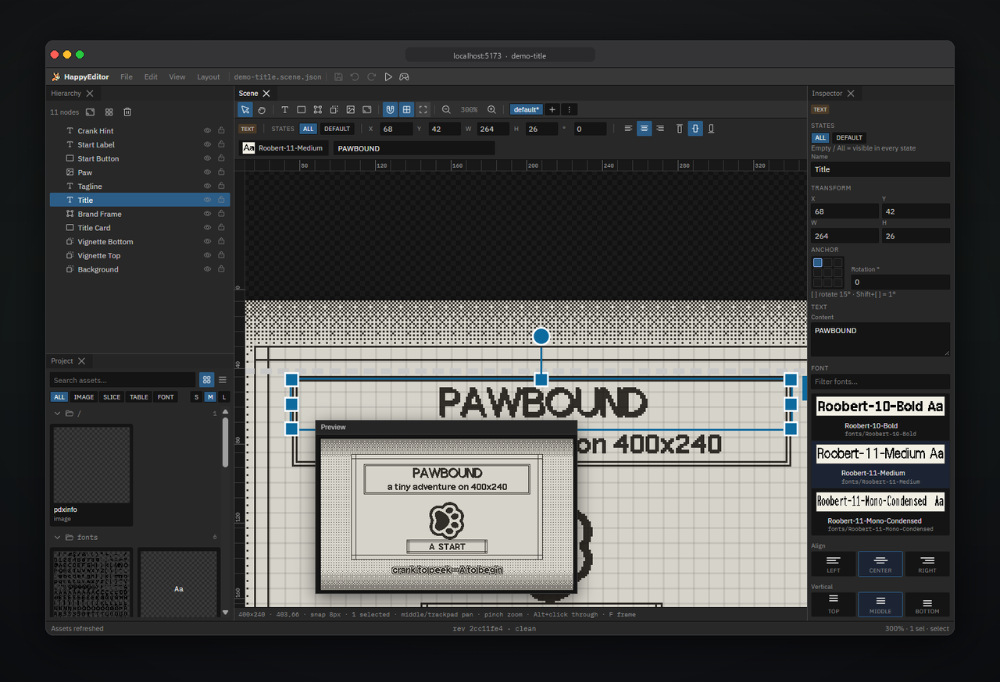
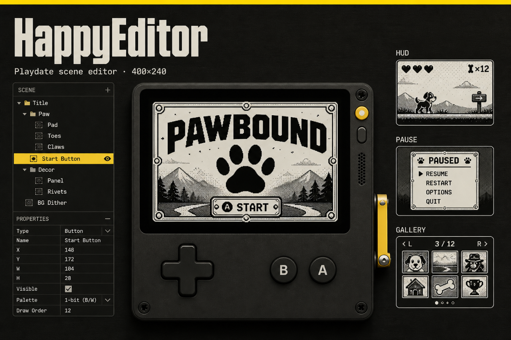

# HappyEditor

Browser scene editor for **Playdate** (400×240). Layouts are authored as JSON, exported to Lua tables, and drawn by a thin runtime in your game.

<p align="center">
  
</p>

| | |
|---|---|
| Package | `happy-editor-playdate` |
| Stack | Bun · Vite · React · TypeScript · Playdate Lua |
| Scene format | [`docs/SCENE_FORMAT.md`](docs/SCENE_FORMAT.md) · [`schema/playdate-scene.schema.json`](schema/playdate-scene.schema.json) |

## Quick start

```bash
bun install
bun dev
```

Open the URL Vite prints (usually `http://localhost:5173`). The Project panel lists scenes; start with the demos below.

```bash
bun test
bun run build
bun run scenes:validate
bun run scenes:generate   # JSON → playdate/Source/scenes/*.lua
```

## Demo scenes

Open any of these from the Project panel (or set `activeScene` in `.playdate-editor/workspace.json`):

| Scene | File | What it shows |
|---|---|---|
| **demo-title** | `playdate/scenes/demo-title.scene.json` | Title card, dither BG, 9-slice panel, button, paw art |
| **demo-hud** | `playdate/scenes/demo-hud.scene.json` | In-game HUD, HP bar, minimap, prompt group, `default`/`hurt` states |
| **demo-pause** | `playdate/scenes/demo-pause.scene.json` | Pause menu + confirm dialog via screen states |
| **demo-gallery** | `playdate/scenes/demo-gallery.scene.json` | Node type sampler (shapes, type, assets) |
| menu | `playdate/scenes/menu.scene.json` | Small fixture sample |
| parity-* | `playdate/scenes/parity-*.scene.json` | Visual-parity harness scenes |

**Screen states:** use the Scene toolbar strip to switch modes (`default` / `confirm`, etc.), **Alt+[ / ]** to cycle, and States chips in the options bar / Inspector to assign nodes (`All` = every state). On device: `Ui.setState("confirm")` — details in [`docs/SCENE_FORMAT.md`](docs/SCENE_FORMAT.md).

After editing JSON (or saving in the editor), Lua under `playdate/Source/scenes/` regenerates automatically while `bun dev` is running.

## Playdate fixture

Harness under `playdate/` — compile and open in the Simulator:

```bash
bun run gen:assets       # regenerate UI slice PNGs (optional)
bun run build:playdate   # → playdate/Editor.pdx
```

Open `playdate/Editor.pdx` in the Playdate Simulator. Requires `PLAYDATE_SDK_PATH` / `pdc` on PATH.

Visual parity (editor canvas ↔ Simulator pixels):

```bash
bun run test:visual      # default scene set
bun run test:visual:all  # every scene
```

Artifacts: `.playdate-editor/visual/` (`*-preview.png`, `*-sim.png`, `*-diff.png`).

## Use as a git submodule

Ideal layout — the **host game** owns assets and scenes; this repo is only the editor tooling:

```text
my-game/                         ← project root (HAPPY_EDITOR_ROOT)
  .playdate-editor/
    project.json                 ← path config (committed)
    workspace.json               ← local panel layout (optional)
  Source/                        ← Playdate Source (images, fonts, ui.lua, …)
    images/
    fonts/
    scenes/                      ← generated *.lua
  scenes/                        ← *.scene.json (source of truth)
  editor/                        ← git submodule (this repo)
```

### 1. Add the submodule

```bash
cd my-game
git submodule add <this-repo-url> editor
cd editor && bun install
```

### 2. Configure paths

Create `my-game/.playdate-editor/project.json`:

```json
{
  "version": 1,
  "sceneRoot": "scenes",
  "sourceRoot": "Source",
  "generatedLuaRoot": "Source/scenes",
  "assetRoots": ["Source/images", "Source/fonts"],
  "defaultScene": "menu",
  "pdxOut": "Editor.pdx",
  "assistant": {
    "provider": "cursor"
  }
}
```

A copy lives at [`docs/examples/host-project.json`](docs/examples/host-project.json).

Optional `assistant.provider` enables **Nibble** (pixel-dog scene assistant): `"cursor"` | `"claude"` | `"codex"`. The matching CLI must be on `PATH`. See [`docs/NIBBLE.md`](docs/NIBBLE.md).

### 3. How the editor finds assets

The editor indexes **everything under `sourceRoot`** (images, fonts, imagetables, 9-slices). Paths in scene JSON are Playdate-style bases relative to Source, e.g. `images/panel`, `fonts/Roobert-11-Medium`.

**Project root** resolution (first match wins):

1. **`HAPPY_EDITOR_ROOT`** or **`PLAYDATE_EDITOR_ROOT`** — absolute or relative to the process cwd  
2. **Parent-host auto-detect** — if you run `bun dev` inside the submodule and the parent folder looks like a Playdate game (`Source/pdxinfo` plus `scenes/` or `.playdate-editor/`), the parent is used  
3. **Current working directory** — if it contains `.playdate-editor/project.json` or the fixture `playdate/` layout  
4. **Editor package root** — standalone use of this repository

Examples:

```bash
# Explicit (always clear)
cd editor
HAPPY_EDITOR_ROOT=.. bun dev          # Unix
$env:HAPPY_EDITOR_ROOT=".."; bun dev  # PowerShell

# Zero-config submodule: parent has Source/ + scenes/
cd editor
bun dev
```

Confirm what was resolved:

```bash
bun run project:info
```

Install the editor-owned UI runtime into the host with `bun run runtime:sync`.
Use `bun run runtime:check` in CI to detect a stale or hand-edited installation.
The command copies `playdate/Source/ui.lua` and its `ui/` support modules into
the configured `sourceRoot`; `import "ui"` loads those support modules itself.
Fonts and images remain owned by the host game.

### Standalone (this repo)

Default config is already in [`.playdate-editor/project.json`](.playdate-editor/project.json):

| Key | Default (fixture) |
|---|---|
| `sceneRoot` | `playdate/scenes` |
| `sourceRoot` | `playdate/Source` |
| `generatedLuaRoot` | `playdate/Source/scenes` |
| `assistant.provider` | `cursor` (optional; enables Nibble) |

## Nibble

Click the menubar dog (or **Mod+Shift+N**) to open Nibble. Configure `assistant.provider` in project.json, keep the CLI on `PATH`, then Ask or Edit the current scene. Details: [`docs/NIBBLE.md`](docs/NIBBLE.md).

## Asset naming (no meta files)

| Pattern | Meaning |
|---|---|
| `foo.png` | image |
| `foo-table-32-32.png` | Playdate imagetable |
| `foo-table-001.png` | sequential imagetable frame |
| `foo-slice-8-8-8-8.png` | 9-slice · insets L R T B |
| `Name-11.fnt` | font (+ companion bitmap table) |

Fixture art includes slices under `playdate/Source/images/` and Roobert fonts from [playdate-juice](https://github.com/jenissimo/playdate-juice).

## Runtime sketch

```lua
import "ui"
import "scenes/demo-title"

Ui.load(DemoTitleScene)  -- module name from generated file

function playdate.update()
  local dt = playdate.getElapsedTime()
  playdate.resetElapsedTime()
  Ui.update(dt)
  playdate.graphics.clear(playdate.graphics.kColorWhite)
  Ui.draw()
end
```

See [`docs/SCENE_FORMAT.md`](docs/SCENE_FORMAT.md) for node types, anchors, and the full `Ui.*` API.

## Scripts

| Script | Purpose |
|---|---|
| `bun dev` | Web editor + project bridge |
| `bun run build` | Typecheck + Vite production build |
| `bun run build:playdate` | `pdc` → `.pdx` |
| `bun run scenes:validate` | Schema-check all scenes |
| `bun run scenes:generate` | Regenerate Lua from JSON |
| `bun run project:info` | Print resolved root / paths |
| `bun run assets:index` | Dump indexed assets as JSON |
| `bun run test:visual` | Simulator ↔ canvas pixel diff |

## Screenshots

The intro image is a live capture of the editor (`demo-title`) in a browser chrome. Marketing still:

<p align="center">
  
</p>

Capture your own from the editor canvas or Simulator; drop extras under `docs/images/` if you extend the gallery.
